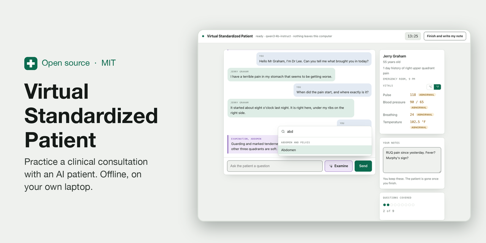
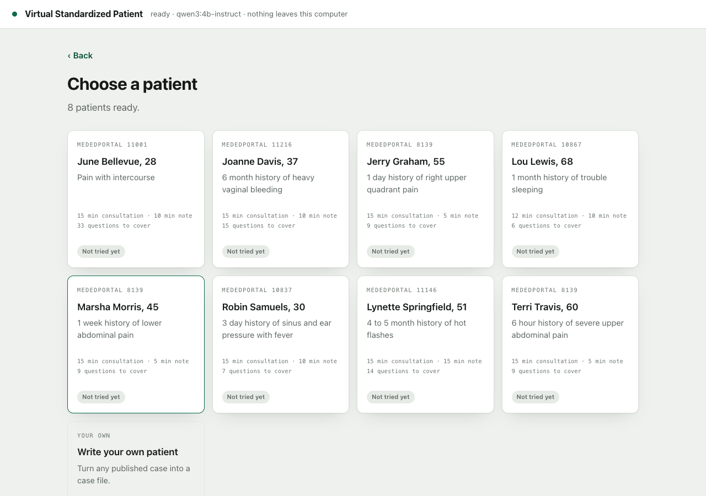
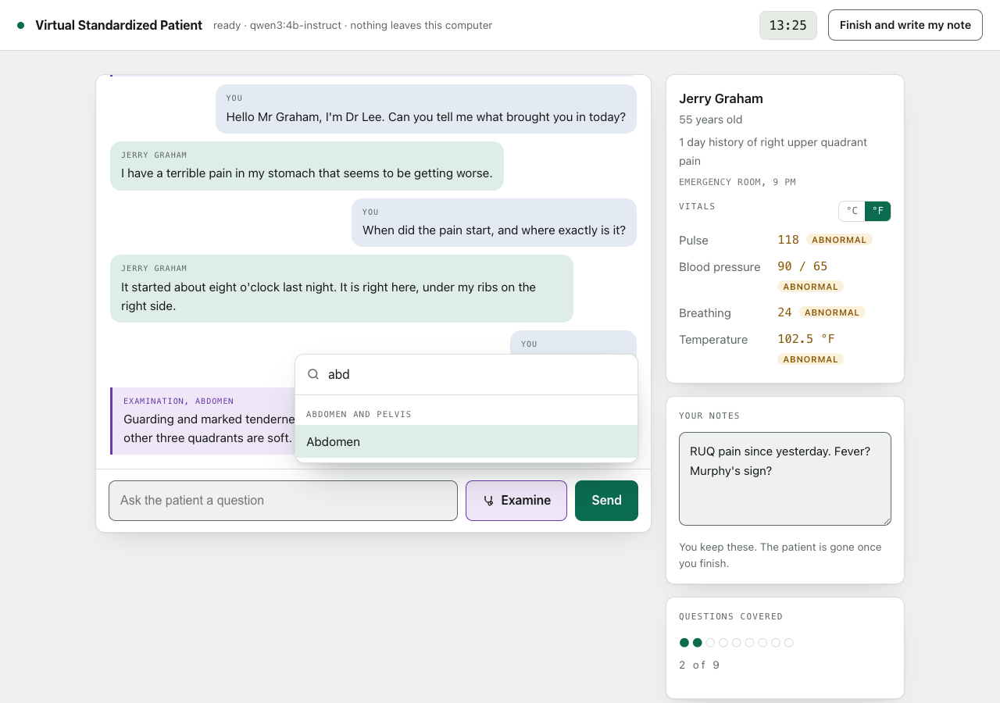
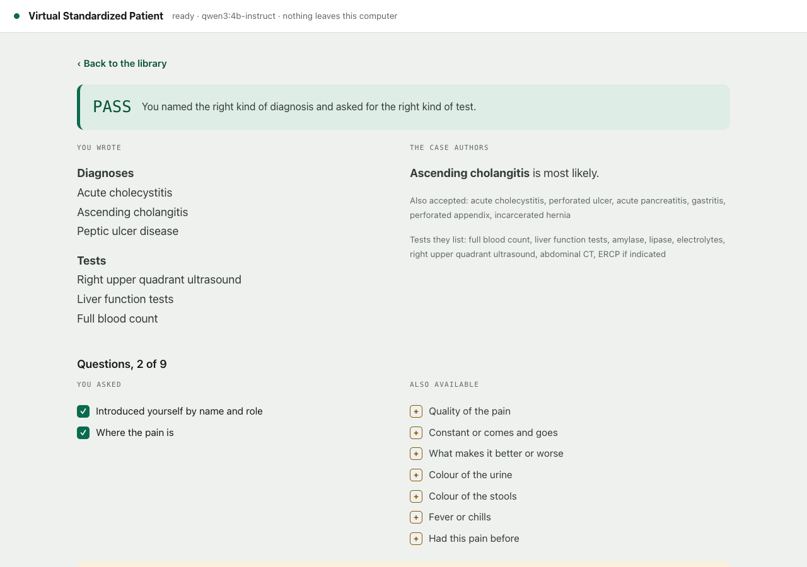
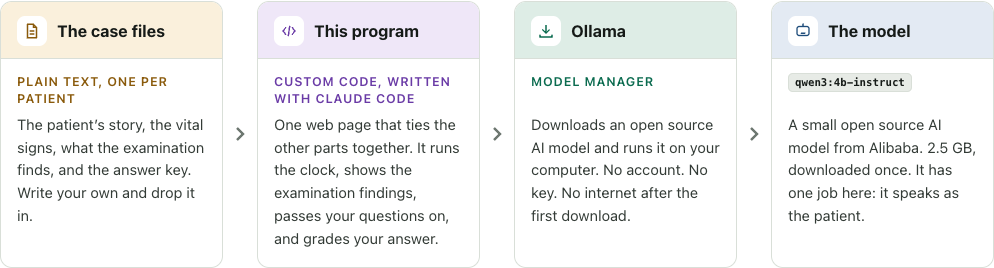
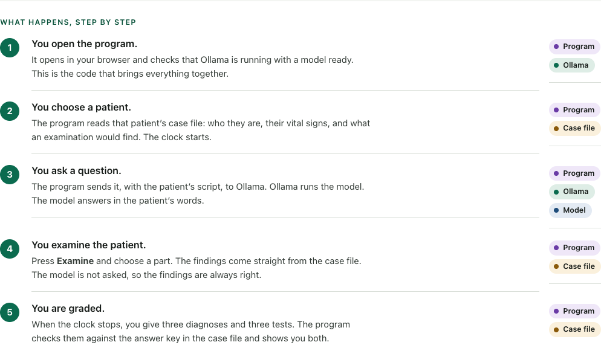

  

<h1 align="center">Virtual Standardized Patient Simulator</h1>

  Practice a clinical consultation with a simulated patient. Interview, examine, diagnose, and see how you did.

  
  
  
  
  

  <a href="#choose-how-to-use-it"><b>Choose a version</b></a> ·
  <a href="#install-the-offline-version"><b>Install</b></a> ·
  <a href="#how-it-works"><b>How it works</b></a> ·
  <a href="https://igembitsky.github.io/virtual-standardized-patient/benchmark.html"><b>Benchmark</b></a> ·
  <a href="docs/for-developers.md"><b>For developers</b></a>

---

The patient is played by an AI model. The examination findings, the clock, and the marking come
from a case file written by clinicians. The eight patients are adapted from peer-reviewed OSCE
cases published in [MedEdPORTAL](https://www.mededportal.org/).

We first showed the simulator at the
[5th Annual Global Health Conference](https://www.theglobalhealthacademy.org/global-health-academy/global-health-conferences/2026-home)
in Southbury, Connecticut, in September 2026. It showed that an AI model can run on an ordinary
laptop, with no internet, for teaching.

## Choose how to use it

There are two versions. This repository is the **offline version**.

| | **Web version** (early version) | **Offline version** (this repository) |
|---|---|---|
| **Devices** | Phone, tablet, or computer | Laptop or desktop: Mac, Windows, or Linux |
| **Install** | Nothing to install | About 15 minutes, with a 2.5 GB download |
| **Internet** | Needed | Needed only for the first download |
| **Privacy** | Your questions go to a hosted AI model | Nothing leaves your computer |
| **Patients** | 22 patients, set in 10 countries | 8 patients |
| **Languages** | 10 languages | English |
| **The AI model** | A larger hosted model: faster and more accurate | `qwen3:4b-instruct`, on your computer |
| **Access** | By request, free for the Global Health Academy partner network | Free and open source, for anyone |

**[Request access to the web version →][web]**  
**[Install the offline version →](#install-the-offline-version)**

> [!NOTE]
> The offline version does not work on a phone. A phone browser cannot hold the AI model in
> memory. On a phone, use the [web version][web]. To read why, see
> [decision 0001](docs/decisions/0001-phone-version.md).

## What it does

<table>
  <tr>
    <td width="33%"></td>
    <td width="33%"></td>
    <td width="33%"></td>
  </tr>
  <tr>
    <td><b>1. Choose a patient.</b> You see their age, complaint, and vital signs.</td>
    <td><b>2. Interview and examine.</b> Type your questions. Press <b>Examine</b> and choose a body part.</td>
    <td><b>3. Diagnose.</b> Write three diagnoses and three tests against the clock. See them beside the case authors' answer.</td>
  </tr>
</table>

- Every encounter is saved on your computer.
- You can download an encounter as one text file to send to a tutor.

## Install the offline version

| | Mac | Windows | Linux |
|---|---|---|---|
| **System** | macOS 14 Sonoma or newer | Windows 10 (22H2) or 11 | 64-bit Ubuntu, Fedora, Debian, and others |
| **Memory (RAM)** | 8 GB | 8 GB | 8 GB |
| **Free disk space** | 4 GB | 7 GB | 7 GB |
| **Download, once** | 2.7 GB | 4.1 GB | 3.9 GB |
| **Instructions** | **[Install on a Mac](docs/install-mac.md)** | **[Install on Windows](docs/install-windows.md)** | **[Install on Linux](docs/install-linux.md)** |

Each page has every step, from the first download to the first patient. The install takes about
15 minutes. Most of that time is the model download.

After the install:

1. Double-click **Start on Mac**, **Start on Windows**, or **Start on Linux**.
2. The simulator opens in your browser. No other window opens.
3. To stop it, close the tab or press **Quit**. It gives the memory back.

If a step does not work, see [If something goes wrong](docs/troubleshooting.md). What changed
in each version is in the [changelog](CHANGELOG.md).

## How it works

The offline version has four parts. All of them are open source.

| Part | License |
|---|---|
| The case files | CC BY |
| This program | MIT |
| [Ollama](https://ollama.com) | MIT |
| The model, `qwen3:4b-instruct` | Apache 2.0 |

The model has one job: it speaks as the patient. The examination findings, the question count,
and the marking come from the case file, so they are always correct.

An automated test checks that the patient keeps to its case. The results are on
[the benchmark page](https://igembitsky.github.io/virtual-standardized-patient/benchmark.html).

## Privacy and security

- **Nothing leaves your computer.** Your questions go only to Ollama, on your own computer at
  `127.0.0.1:11434`. Saved encounters stay in your browser.
- **One small request, and one count.** At start, the page asks the project's web server for the
  newest version number, to see if a new version exists. It sends only its own version number, for
  example 1.3.2. The server counts the starts for each version, so the team knows how many people
  use the simulator. It keeps no address, no ID and no cookie, and never sees your questions or
  encounters. If the server does not answer, the page asks GitHub for the file `VERSION` instead.
  Search `app/index.html` for `fetch(` to see every request.
- **No account, no sign-in, no cookies.** The download link and GitHub count downloads, as GitHub
  does for every project.
- **The launcher installs nothing.** It uses a program your system already has: Perl on a Mac,
  PowerShell on Windows, Python on Linux.
- **This computer only.** The launcher listens on `127.0.0.1`. Other computers on your network
  cannot reach it, and other web sites cannot use it.
- **No automatic updates.** When a new version exists, the page shows a link. You download it
  yourself.

Automated checks run on every change:

- **Launcher tests** run each launcher on a real Mac, Windows, and Linux machine, from the same
  ZIP you download. They include the attacks that an independent audit tried.
- **CodeQL**, GitHub's code scanner, looks for security defects.
- **OpenSSF Scorecard** checks the project's security practices.

These checks find known kinds of problems. They cannot prove that a program has none. To report
a security problem privately, see [SECURITY.md](SECURITY.md).

> [!WARNING]
> - This is a teaching tool. Nothing here is medical advice.
> - The patients are invented.
> - The model is small and can make mistakes while it sounds certain.
> - No clinician checks what the program produces.

## Contributing

Contributions are welcome: a new case, a translation, a fix, or a better install guide.

- Read [CONTRIBUTING.md](.github/CONTRIBUTING.md) first.
- To report a problem, [open an issue](https://github.com/igembitsky/virtual-standardized-patient/issues/new/choose).
- To write your own patient, see [For developers](docs/for-developers.md#make-it-your-own).
- Everyone who takes part agrees to the [Code of Conduct](.github/CODE_OF_CONDUCT.md).

## Citation

If you use the simulator in teaching or research, please cite it. GitHub shows the citation in
APA and BibTeX under **Cite this repository**, from [`CITATION.cff`](CITATION.cff).

> Gembitsky I. Virtual Standardized Patient Simulator. 2026.
> https://github.com/igembitsky/virtual-standardized-patient

## License and credit

**The program** is copyright 2026 Igor Gembitsky, under the [MIT license](LICENSE). You may use
it, copy it, change it, and give it to other people, for any purpose. Keep the copyright line.

**The cases** are used under the Creative Commons Attribution license. See
[`app/cases/LICENSE.md`](app/cases/LICENSE.md). That license asks for three things:

1. Name the authors, with the title, the year, and a link to the original.
2. Say what you changed.
3. Name the license.

This program does all three. The credit appears at the top of every case file, in the program,
and in every downloaded report. If you pass on or change a case, keep that credit with it. For
example:

> Falcone J, Ogilvie J. *Three Adult Acute Abdominal Pain Objective Structured Clinical
> Examination (OSCE) Cases for Medical Student Assessment in the Surgery Clerkship.*
> MedEdPORTAL. 2011. doi:10.15766/mep_2374-8265.8139

## About

Made by **Igor Gembitsky**, invited speaker on artificial intelligence in medical education at
the 5th Annual Global Health Conference, 2026.

- Building on this for your school or program? I am glad to talk it through.
- Want to commission work or a talk? Write to me on
  [LinkedIn](https://www.linkedin.com/in/gembitsky).

[web]: https://virtual-patient-staging.onrender.com
